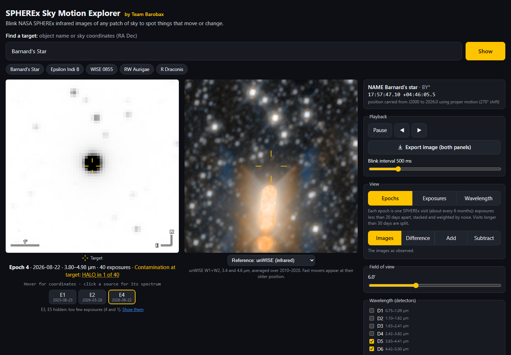

# SPHEREx Sky Motion Explorer

A web tool that blinks NASA SPHEREx infrared images of any patch of sky, so anyone can spot objects
that move (nearby stars, brown dwarfs) or change brightness (variable stars), and that automatically
flags moving sources Gaia has never catalogued.

Built by Team Barobax for the NASA Space Apps Challenge 2026 ("SPHEREx Sky Motion Explorer").
**Live demo:** https://spherex.peykan.ai



## What it does

- **Search** by name (CDS Sesame, carried to today with the star's proper motion) or coordinates.
- **Blink** through survey visits ("epochs", one stack per ~6-month visit), single exposures, or all
  102 SPHEREx wavelengths as a spectrum movie. One brightness scale across all frames, so changes are real.
- **Image arithmetic:** each frame minus the average, or add / subtract any chosen sets of visits.
- **Overlays:** Gaia DR3 and CatWISE2020 sources moved to each frame's date (SIMBAD names on hover),
  and the SPHEREx contamination flags (ghosts, halos, streaks, crosstalk) as a pixel map.
- **Click a star** for its spectrum per visit and a brightness curve compared at matched wavelengths
  (so different wavelength sampling is not mistaken for variability). CSV export.
- **Moving-source detection** that labels each mover *known*, *candidate*, *doubtful* or *unchecked*.
- **Reference panel:** unWISE, Legacy Survey, a stack of all SPHEREx visits, or the interactive Aladin Lite atlas.
- **Your own data:** upload FITS images with a WCS ("FITS + WCS v1", below) and explore them the same way.
- Always current: new SPHEREx releases are discovered automatically; "Check for new data" searches again.
- Shareable links, side-by-side PNG export, and an embed mode (`&embed=1`).

## How it works

SPHEREx is not an ordinary imager: each detector sits behind a linear variable filter, so every
exposure sees each part of the sky at a *different wavelength*. Playing raw exposures in time order
would mostly show colour changes, not motion. So the backend:

1. **Searches** IRSA (SIA, with TAP as fallback) for every spectral image covering the position, in the
   newest data and quick releases, found by listing the public S3 bucket.
2. **Reads only what it needs** straight from the public S3 bucket with HTTP range requests: the IMAGE
   rows, the RICE-compressed FLAGS rows (decoded locally) and the wavelength table, under 1 MB per
   exposure instead of a ~4 MB cutout, about **24× faster** than IRSA's cutout service.
3. **Cleans and aligns** each exposure: masks bad pixels, removes the local sky (zodiacal light differs
   between visits), reprojects onto one north-up grid at the native 6.15″ pixel.
4. **Groups exposures into epochs** (gaps over 20 days split visits; long visits near the ecliptic poles
   are cut into 30-day windows) and stacks each epoch with inverse-variance weights.

### Moving-source detection

1. Detect sources in every epoch stack (SEP) with windowed sub-pixel centroids, only where that epoch
   has real coverage, so a star cut by an image edge never gets a false centroid.
2. Link detections across epochs: any epoch can start a track, straight-line motions through every
   brightness-consistent neighbour are tried, and each detection is assigned to one track only.
3. Fill missed epochs with forced measurements at the predicted position.
4. **Calibrate the position errors on the field itself.** Almost every source is still, so each track's
   χ² should sit at the median expected for its degrees of freedom; a systematic floor and a
   signal-to-noise term are fitted separately for bright and faint stars.
5. Keep motions that are ≥ 5σ and ≥ 0.3″/yr over 3+ epochs, seen in most epochs that cover them, and
   still ≥ 3σ when any single point is left out (one bad centroid cannot fake a motion).
6. Compare with Gaia DR3 carried to each epoch by full motion vector: **known** (a Gaia star moves the
   same way), **candidate** (no Gaia star on the track), **doubtful** (saturated, or a Gaia star sits on
   the track but moves differently) or **unchecked** (Gaia unreachable).

On the challenge targets it recovers Barnard's Star (10.3″/yr) and Epsilon Indi B (4.4″/yr) as known,
flags the cold brown dwarf WISE 0855, which Gaia cannot see, as a candidate (7.5″/yr), and reports no
false movers for the variable stars RW Aur and R Dra.

### Engineering notes

- **One job per detector**, combined per view: adding a detector processes only that detector, and
  removing one (or returning to a combination seen before) needs no work at all.
- **Priority queue:** a free processing slot goes to the view someone is looking at; queued work nobody
  asks about any more gives up its place.
- **Progressive loading:** frames appear and sharpen while exposures are still arriving; finished image
  stacks are cached on disk.
- Saturated stars have masked cores: their brightness is measured in a fixed ring around the core.
- 44 backend tests, including synthetic star fields for the mover search (crowded fields, image edges,
  a fake motion on a still Gaia star, a mover missing from one epoch).

## Tech stack

- **Backend:** Python 3.11, FastAPI, Astropy, reproject, NumPy, SciPy, SEP
- **Frontend:** React, TypeScript, Vite, HTML canvas, Aladin Lite
- **Data:** NASA SPHEREx via NASA/IPAC IRSA and the public SPHEREx S3 bucket; ESA Gaia DR3; CatWISE2020
  and Gaia via VizieR; CDS Sesame and SIMBAD; unWISE / Legacy Survey imagery

## Run it

**With Docker** (backend and frontend together):

```bash
docker compose up
# open http://localhost:5173
```

**Without Docker** (Python 3.11 and Node 20.19+ or 22.12+):

```bash
python -m venv .venv
.venv/bin/pip install -r backend/requirements.txt         # Windows: .venv\Scripts\pip
cd backend && ../.venv/bin/uvicorn app.main:app --port 8000

# in another terminal
cd frontend && npm install && npm run dev                 # http://localhost:5173, proxies /api to :8000
```

A new position takes about 10–30 s per detector the first time (the archive search can take longer);
after that it is cached in `backend/.cache`.

**Tests:** `cd backend && ../.venv/bin/python -m pytest tests`

## Upload your own images ("FITS + WCS v1")

- One FITS file per exposure (`.fits`, `.fit`, `.fts`, optionally `.gz`).
- **Required:** a 2-D image (first image HDU, or an extension named `IMAGE`/`SCI`), a celestial WCS
  (RA/Dec), and an observation time (`MJD-OBS`, `MJD-AVG` or `DATE-OBS` in UTC).
- **Optional:** noise as `VARIANCE`, `ERR` (1σ) or `WEIGHT` (inverse variance); bad pixels as `MASK`,
  `FLAGS` or `DQ` (non-zero = bad); `WAVELEN` (µm) or `FILTER`; `BUNIT`.
- **Limits:** 50 files, 100 MB each, 1 GB per dataset, images up to 6000 × 6000; per client, 3 new
  datasets and 60 files per minute.
- Each dataset gets an unguessable private link (`?dataset=<id>`) and is deleted after 7 days.
- Files that break the standard are skipped and listed with the reason.

## API

| Endpoint | Purpose |
|---|---|
| `GET /api/resolve?q=` | Name or coordinates to a position at today's date |
| `GET /api/frames?ra&dec&fov&dets&mode&release&deep&refresh` | Starts or polls a view; `mode` = epoch, exposure or wavelength; frames as base64 float32 |
| `GET /api/movers?ra&dec&fov&dets&release&deep` | Moving sources with status, motion, significance and per-epoch positions (`debug=1` adds every track) |
| `GET /api/photometry?ra&dec&fov&dets&x&y` | Aperture photometry at a grid pixel for every exposure |
| `GET /api/exposures?ra&dec&fov&dets` | Metadata for every exposure |
| `GET /api/gaia?ra&dec&radius`, `GET /api/catwise?ra&dec&radius` | Catalogue sources for the overlays |
| `GET /api/releases` | Releases found in the archive, and what "Newest" means |
| `POST /api/datasets`, `PUT /api/datasets/<id>/files/<name>` | Create a dataset, upload one FITS file (raw body) |

## Layout

```
backend/    FastAPI science service (app/), tests, Dockerfile
frontend/   React + Vite single-page app
assets/     README screenshot
```

## Credits

NASA SPHEREx data via the NASA/IPAC Infrared Science Archive (IRSA); ESA Gaia DR3; CatWISE2020 (NASA
WISE / NEOWISE); CDS Sesame, SIMBAD, VizieR and Aladin Lite; unWISE and Legacy Survey imagery.
